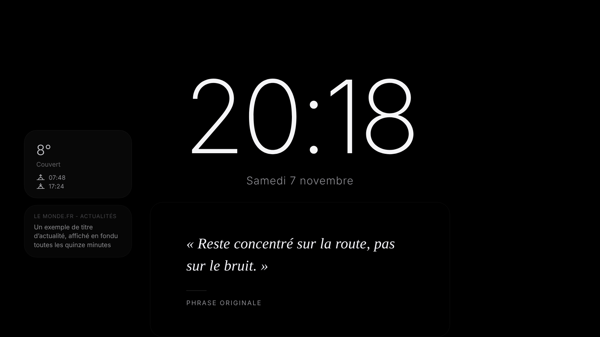
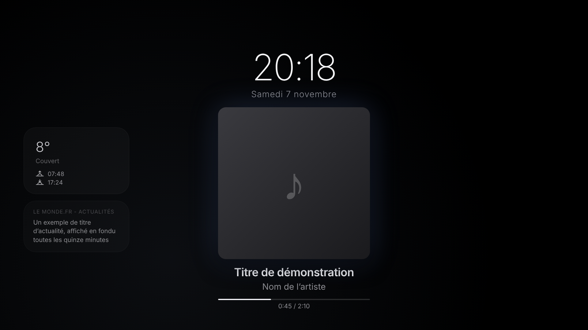
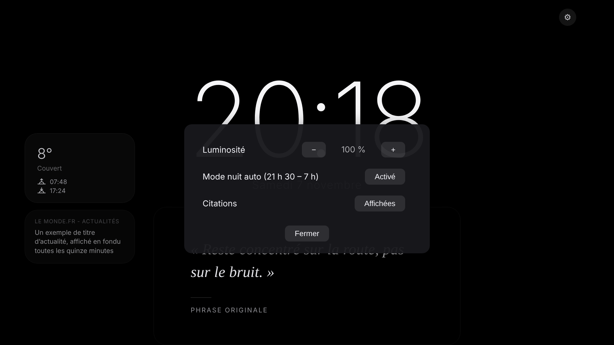
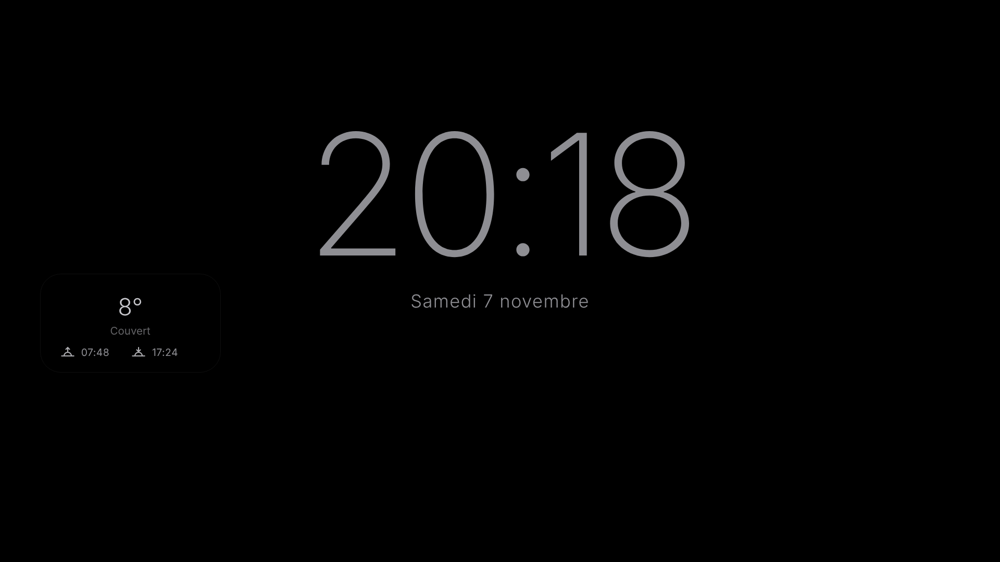

# Dashboard Esteban

Un tableau de bord **façon Apple StandBy / iPadOS** pour une vieille tablette Android en paysage, ou pour n'importe quel écran. Il tourne dans un navigateur : pas d'application à installer, pas de compte à créer.

Horloge, date, météo, lever et coucher du soleil, citations, actualités, morceau en cours sur Spotify (via Last.fm), mode nuit automatique, mode veille et réglages, le tout sobre et noir.



| Lecture Spotify | Réglages | Mode nuit |
|---|---|---|
|  |  |  |

> Les captures utilisent des données de démonstration (morceau fictif, météo et actualité d'exemple).

## Fonctionnalités

- **Horloge** centrée, grande et lisible, avec la date en dessous.
- **Météo** de votre ville (Open-Meteo, sans clé), avec le lever et le coucher du soleil calculés localement.
- **Citations** : une citation change chaque heure, une citation du jour apparaît le matin, et des citations d'artistes peuvent être ajoutées.
- **Actualités** : titres de sources françaises, changés toutes les 15 minutes en fondu.
- **Spotify** : pochette, titre, artiste et barre de progression du morceau en cours, via Last.fm. Si rien ne joue, les citations reprennent.
- **Mode nuit** automatique de 21 h 30 à 7 h, désactivable.
- **Mode veille** après 30 minutes sans activité, qui ne laisse que l'horloge.
- **Réglages** (bouton ⚙) : luminosité, affichage des citations, mode nuit auto.
- **Plein écran** (bouton ⛶) et indicateur de connexion discret.
- **Mise à jour automatique** : la page vérifie chaque demi-heure s'il existe une nouvelle version, et ne se recharge qu'entre 3 h et 5 h, et jamais pendant qu'un morceau joue.

## Prérequis

- Un navigateur récent (Chrome, Firefox, Edge, Samsung Internet).
- Pour la configuration depuis le terminal : `git` et `python3`.
- Facultatif : un compte [Last.fm](https://www.last.fm) et une clé API, pour afficher Spotify.

## Installation depuis le terminal

```bash
# 1. Télécharger le projet
git clone https://github.com/<votre-pseudo>/dashboard-for-android-5.5.git
cd dashboard-for-android-5.5

# 2. Configurer (clé et pseudo Last.fm, facultatifs)
./setup.sh

# 3. Tester dans le navigateur
python3 -m http.server 8000
# puis ouvrir http://localhost:8000
```

Sans Git : téléchargez l'archive ZIP de la branche principale.

```bash
curl -L -o dashboard.zip https://github.com/<votre-pseudo>/dashboard-for-android-5.5/archive/refs/heads/main.zip
unzip dashboard.zip
cd dashboard-for-android-5.5-main
./setup.sh
```

## Obtenir une clé Last.fm (pour Spotify)

1. Créez un compte sur [last.fm](https://www.last.fm) et connectez Spotify à Last.fm (*Settings → Applications*).
2. Créez une clé API sur [last.fm/api/account/create](https://www.last.fm/api/account/create).
3. Lancez `./setup.sh` et collez la clé et votre pseudo.

Sans clé, le dashboard fonctionne quand même : il affiche simplement les citations.

## Mettre en ligne (GitHub Pages)

1. Poussez le projet sur votre compte GitHub, dans un dépôt **public**.
2. Dans le dépôt : *Settings → Pages → Build and deployment → Deploy from a branch → `main` / `(root)`*.
3. Après une minute, le dashboard est disponible sur `https://<votre-pseudo>.github.io/dashboard-for-android-5.5/`.

Les clés Last.fm et le pseudo sont écrits dans `script.js`. Si vous publiez votre propre copie, ne la rendez publique qu'après avoir retiré vos clés, ou utilisez un dépôt privé avec un compte GitHub payant (GitHub Pages n'est pas disponible sur un dépôt privé gratuit).

## Installer sur la tablette

1. Ouvrez l'adresse du dashboard dans le navigateur de la tablette.
2. Passez en plein écran avec le bouton ⛶ (ou F11 sur un ordinateur).
3. Désactivez la mise en veille de l'écran dans les réglages de la tablette.

Le projet est conçu pour fonctionner sur Android 5.1 (navigateur d'origine). Sur un appareil plus ancien, certains effets visuels peuvent être plus simples.

## Générer une APK (facultatif, non testé)

Le dashboard est une page web statique : vous pouvez l'envelopper dans une application Android avec Apache Cordova. Les étapes suivantes demandent Node.js, Java JDK et le SDK Android, et n'ont pas été testées sur ce projet.

```bash
npm install -g cordova
cordova create dashboard-apk com.example.dashboard "Dashboard"
cd dashboard-apk
rm -rf www && cp -r /chemin/vers/dashboard-for-android-5.5 www
cordova platform add android
cordova build android
```

L'APK se trouve dans `platforms/android/app/build/outputs/apk/debug/`. Vérifiez la compatibilité de votre version d'Android avant de l'installer.

## Personnaliser

| Quoi | Où | Comment |
|---|---|---|
| Clé et pseudo Last.fm | `script.js`, bloc `CONFIG` | `./setup.sh` ou à la main |
| Coordonnées de la météo | `weather.js`, `LAT` et `LON` | remplacez par votre ville |
| Citations | `quotes.js`, tableau `QUOTES` | ajoutez vos citations (format dans le fichier) |
| Citations personnelles | `quotes.js`, tableau `USER_QUOTES` | remplace les citations par défaut quand il n'est pas vide |
| Sources d'actualités | `news.js`, tableau `FEEDS` | ajoutez des flux RSS |
| Heures du mode nuit | `script.js`, fonction `updateNight` | 21 h 30 à 7 h par défaut |
| Heures de mise à jour | `script.js`, `UPDATE_HOUR_FROM` / `UPDATE_HOUR_TO` | 3 h à 5 h par défaut |

Les réglages du bouton ⚙ sont gardés dans le navigateur de l'appareil.

## Structure du projet

```
index.html    structure de la page
style.css     apparence (mise en page, couleurs, animations)
script.js     logique : horloge, Spotify, mode nuit, réglages, mise à jour
quotes.js     citations
weather.js    météo (Open-Meteo)
news.js       actualités (flux RSS via rss2json)
setup.sh      configuration guidée depuis le terminal
screenshots/  captures d'écran du README
```

## Dépannage

- **Spotify n'affiche rien** : vérifiez la clé et le pseudo, et que Spotify est bien connecté à Last.fm. Le dashboard affiche les citations s'il ne reçoit rien.
- **Pas de météo** : vérifiez la connexion de l'appareil et les coordonnées dans `weather.js`.
- **Une source d'actualités ne s'affiche pas** : son adresse est probablement incorrecte ou ne renvoie pas de flux. Elle est ignorée sans message d'erreur.
- **Écran noir au démarrage** : l'écran de démarrage dure environ 4 secondes.
- **Je ne vois pas la dernière version** : le navigateur garde une copie en cache. Videz les données du site, ou ouvrez l'adresse avec `?v=1` à la fin.

## Licence

Ce projet est distribué sous licence [MIT](LICENSE). Vous pouvez l'utiliser, le modifier et le redistribuer librement, en gardant la mention de copyright.
